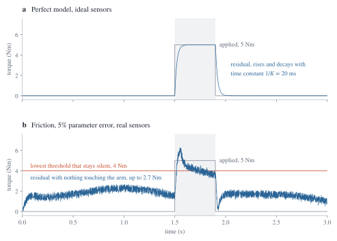
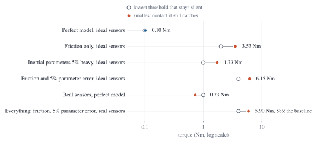
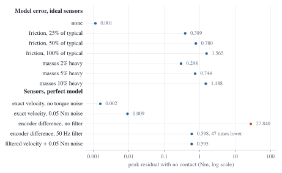

# residual-collision-detection

[](https://github.com/andrealo20/residual-collision-detection/actions/workflows/ci.yml)
[](https://github.com/andrealo20/residual-collision-detection/blob/main/LICENSE)
[](https://en.wikipedia.org/wiki/C99)
[](https://github.com/andrealo20/residual-collision-detection/blob/main/tests)
[](https://github.com/andrealo20/residual-collision-detection/blob/main/.github/workflows/ci.yml)
[](#verified-against-pinocchio)

**Sensorless collision detection for robot arms, from the torque residual.**

The library prefix is `qcollide_`, kept short to avoid symbol collisions; the
repository is named for what it does.

If you know the dynamic model of an arm, you know what torque a given motion
requires. The difference between that and the measured torque is what the
outside world is doing to the robot. Detect it and you have collision
detection with no force sensor, no skin, and no extra hardware, which is the
mechanism behind collaborative robots that stop when you touch them.

[](docs/images/residual_trace.svg)

*The residual tracks the external torque. With a perfect model it settles on
the applied value and returns to zero; with ordinary model error and real
sensors it rides on a floor that any threshold has to clear first.*

## The result 

[](docs/images/tradeoff.svg)

**A 0.1 Nm touch becomes a 5.9 Nm push once ordinary model error and real
sensors are present.** That factor of roughly sixty is what this project
measures, and it is the reason collaborative robots identify their friction
models carefully rather than trusting CAD inertias: every newton metre of
unmodelled torque is a newton metre of contact you can no longer feel.

---

## Why the naive approach does not work

The obvious formulation reads the external torque straight off the equation
of motion:

$$
\tau_{\text{ext}} = \tau_{\text{meas}} - M(q)\ddot{q} - C(q,\dot{q})\dot{q} - g(q)
$$

and it fails in practice, because $\ddot{q}$ is not measured. Getting it means
differentiating joint position twice, and each differentiation multiplies
high-frequency noise by the sampling rate. At 1 kHz, a position signal with a
micrometre of encoder noise produces an acceleration estimate whose noise
dwarfs the contact you are trying to detect.

The momentum observer avoids $\ddot{q}$ entirely. It works with the
generalized momentum $p = M(q)\dot{q}$, whose derivative is

$$
\dot{p} = \tau + C(q,\dot{q})^{\top}\dot{q} - g(q) + \tau_{\text{ext}}
$$

with no acceleration term anywhere. That identity holds precisely because
$\dot{M} - 2C$ is skew-symmetric, which is why this repository is careful
about *which* Coriolis matrix it computes, see below. Integrating that
expression and comparing against the measured momentum gives a residual that
converges to $\tau_{\text{ext}}$ and is driven by measured quantities only.

---

## M0: the plant

`src/dynamics.c` is an n-link planar arm: mass matrix, Coriolis matrix,
gravity, forward and inverse dynamics, RK4 integration. Planar keeps the
algebra small enough to check by hand, which matters because everything else
in the project is measured against this model.

### Verified against Pinocchio

The plant is the reference the observer is judged by, so it cannot be taken
on trust. An error here would produce an observer that appears to work while
measuring the wrong thing, and no self-written test catches a shared
misunderstanding of the model. [Pinocchio](https://github.com/stack-of-tasks/pinocchio)
is an independent implementation by another group, so agreement rules that
out. The same arrangement [qdsp](https://github.com/andrealo20/qdsp) has with
CMSIS-DSP.

```
pip install numpy pin
python3 tools/check_dynamics.py
```

Maximum absolute disagreement over 60 random configurations at 1, 2, 3 and 4
links:

| Quantity                            | Max difference | Limit |
| ------------------------------------ | -------------- | ----- |
| Mass matrix $M(q)$                   | 5.3e-15        | 1e-10 |
| Gravity $g(q)$                       | 2.8e-14        | 1e-10 |
| Coriolis term $C(q,\dot{q})\dot{q}$  | 8.1e-09        | 1e-05 |
| Forward dynamics $\ddot{q}$          | 5.6e-08        | 1e-04 |

The tolerances differ for reasons rather than by taste. M and g are
closed-form in both implementations and agree to machine precision. The
Coriolis term goes through central differences here, capping accuracy near
the square root of machine epsilon. And $\ddot{q}$ inherits the Coriolis
error amplified by $M^{-1}$, measured amplification is 2.4x median at n=2 and
3.4x at n=4, with the condition number of $M$ reaching 760, so its tolerance
cannot be tighter than the Coriolis one. An earlier version set it to 1e-8
and the code failed for a reason that had nothing to do with correctness.

### The property the whole project rests on

There are infinitely many matrices $C$ for which $C\dot{q}$ gives the correct
Coriolis vector. Only one family makes $\dot{M} - 2C$ skew-symmetric, and the
momentum observer needs that one. Pick another and the observer still runs,
still produces residuals, and those residuals are wrong in a way nothing else
would reveal.

So it is tested directly, by differencing M along the trajectory:

| Measurement                              | Result                     |
| ----------------------------------------- | -------------------------- |
| Skew-symmetry residual of $\dot{M} - 2C$  | 4.1e-09 (matrix scale 6.1) |
| Mass matrix asymmetry                     | 0                          |
| Smallest Cholesky pivot over 200 poses    | 0.032                      |
| Inverse/forward dynamics round trip       | 6.4e-14                    |

### Integration quality

Energy conservation is checked by *convergence order* rather than against a
chosen threshold. The distinction matters: a model with a sign error would
also show small drift at a small step and would pass a threshold test.

| Step   | Relative energy drift over 20 s |
| ------ | -------------------------------- |
| 2.0e-3 | 2.33e-05                         |
| 1.0e-3 | 2.51e-06                         |
| 5.0e-4 | 3.89e-07                         |

Each halving cuts the drift by a factor of 9.3 and then 6.5. Those are not
the factor of 16 a fourth-order method gives on a smooth error term, because
this drift is a maximum over the trajectory rather than a local truncation
error, and the maximum is not a smooth function of the step. What they do rule
out is a first- or second-order scheme, which would give 2 and 4. The direct
measurement of the order is the separate test that halves the step and
compares trajectories against a fine reference: it gets a ratio of 18 to 20
against the 16 expected, which is the fourth-order evidence.

---

## M1: the observer

`src/observer.c` implements the residual

$$
r = K\left( p - \int_0^t \left[\tau + C(q,\dot{q})^{\top}\dot{q} - g(q) + r\right] \mathrm{d}t - p(0) \right)
$$

which satisfies $\dot{r} = K(\tau_{\text{ext}} - r)$ for each joint
independently: a first-order response whose time constant is $1/K$ and
nothing else. That is the continuous-time constant; the discrete update needs
$K \cdot dt$ small relative to 1 for the approximation to hold, comfortably
true at $K\,dt = 50 \times 10^{-4} = 0.005$ in the measurements below, though
not guaranteed for every choice of gain and sample period. Everything in the
observer is measured, position, velocity, torque, with no acceleration
anywhere.

Measured on a two-link arm at 10 kHz, with the observer given the same model
as the plant:

| Measurement                                 | Result                     |
| -------------------------------------------- | --------------------------- |
| Residual after 2 s with no contact           | 0.0                        |
| Residual against an applied 4.0 / -2.0 Nm    | 4.0019 / -2.0004           |
| Time constant at $K = 20/50/100$             | 0.0498 / 0.0198 / 0.0098 s |
| Expected $1/K$                               | 0.0500 / 0.0200 / 0.0100 s |
| Contact on joint 0: loaded / unloaded joint  | 5.9955 / 0.0005 Nm         |
| Worst residual during free swing             | 0.0000 Nm                  |

### Two things that would otherwise fail silently

**The Coriolis transpose.** The residual needs $C^{\top}$, not $C$. Using the
wrong one produces a detector that works perfectly at rest and is wrong
whenever the arm moves, no error, no warning, just residuals that mean
nothing. The test suite exercises free motion specifically to catch it:
substituting $C$ for $C^{\top}$ takes the free-swing residual from 0.0000 to
**7.2 Nm** and fails three tests. That check was verified by deliberately
breaking the code, which is the only way to know a test has teeth.

**The integration rule.** The integrand tracks $\dot{p}$, which grows with
joint velocity, so forward Euler leaves an error proportional to the timestep
times the speed of the arm. On a two-link arm driven to 19 rad/s it produced a
spurious 0.33 Nm on a joint with no external torque at all, well inside the
range of a real light contact. The trapezoidal rule reduces that by a factor
of fifteen at the same step:

| Timestep | Spurious residual, forward Euler | Trapezoidal |
| -------- | ---------------------------------- | ----------- |
| 1.0e-3   | 0.333 Nm                          | 0.022 Nm    |
| 5.0e-4   | 0.165 Nm                          | 0.010 Nm    |
| 2.5e-4   | 0.082 Nm                          | 0.005 Nm    |

Both remain first order overall, because the residual feeds back into its own
integral explicitly; the trapezoidal rule buys a much smaller constant rather
than a better rate.

---

## M2: from residual to decision

`src/detector.c` turns the residual into a trigger. A bare threshold is not
enough: a single sample above it is not evidence of contact, and a detector
that fires on the first excursion produces nuisance stops. So the residual
must stay above the threshold for a number of consecutive samples, and once
triggered it releases only below a lower threshold. Both cost latency and buy
robustness, and the exchange rate is measured rather than argued.

Measured on the two-link arm, perfect model, $K = 50$ (time constant 20 ms):

| Threshold | Detection latency |
| --------- | ------------------ |
| 0.5 Nm    | 2.2 ms             |
| 1.0 Nm    | 4.6 ms             |
| 2.0 Nm    | 10.3 ms            |
| 4.0 Nm    | 32.2 ms            |

| Observer gain | Time constant | Latency at 1 Nm |
| -------------- | ------------- | ---------------- |
| $K = 20$       | 50 ms         | 11.3 ms          |
| $K = 50$       | 20 ms         | 4.6 ms           |
| $K = 100$      | 10 ms         | 2.4 ms           |

Two further results worth stating:

**Minimum detectable torque: 0.9989 Nm at a 1.0 Nm threshold.** Found by
bisection. The residual converges to the applied torque exactly, so the
smallest detectable contact is the threshold itself, no signal is lost
between the contact and the decision.

**Zero false alarms at every threshold tested, down to 0.05 Nm.** That is not
a result about the method, it is the baseline: with a perfect model and no
noise there is nothing to trigger on. It is the number M3 destroys by
introducing friction, and the point of measuring it here is to have something
to compare against.

### A limit of the method, measured rather than discovered later

A contact shorter than the observer time constant can be missed, because the
residual has not risen far enough before the contact ends:

| Contact duration | Fraction of time constant | Outcome    |
| ------------------ | -------------------------- | ---------- |
| 2 ms                | 0.1                        | **missed** |
| 5 ms                | 0.25                       | detected   |
| 20 ms               | 1.0                        | detected   |
| 100 ms              | 5.0                        | detected   |

This is a property of any first-order observer, not a defect of this one, and
whether a short contact is missed depends on the threshold: a rectangular
contact of torque $T$ and duration $d$ drives the residual to at most
$T(1-e^{-Kd})$, so lowering the threshold recovers shorter contacts at the
cost of passing more model error and noise, which is exactly the trade-off
M3 and M4 quantify. Raising $K$ has the same effect from the other side,
shortening the blind window at the same cost.

---

## M3: what model error costs

Everything above ran with the observer holding the *same* model as the plant.
That is not the situation on a real arm, and it is the only reason the
earlier numbers look so clean. M3 removes the assumption.

Two sources of error, each hidden from the observer and each a single
severity number: **friction** present in the plant only, and **inertial
parameter error**, the observer's masses scaled away from the plant's.

The arm moves throughout, both joints swinging 0.6 rad at 0.4 Hz under
computed-torque control, because friction and inertial error only show up
in motion. A detector tested at rest would report a trade-off that does not
exist.

### The residual floor

With no contact at all, model error alone produces a residual. Any usable
threshold has to sit above it.

| Model error           | Peak residual, no contact |
| ----------------------- | -------------------------- |
| none                    | 0.001 Nm                  |
| friction $\times$ 0.25  | 0.389 Nm                  |
| friction $\times$ 0.50  | 0.780 Nm                  |
| friction $\times$ 1.00  | 1.565 Nm                  |
| inertia +2%             | 0.298 Nm                  |
| inertia +5%             | 0.744 Nm                  |
| inertia +10%            | 1.488 Nm                  |

Both enter the residual almost exactly linearly: doubling the parameter error
from 5% to 10% moves the floor from 0.744 to 1.488, a ratio of 2.00, and
doubling friction from half to full moves it from 0.780 to 1.565.

### The trade-off

```
cmake -S . -B build -DCMAKE_BUILD_TYPE=Release
cmake --build build --parallel
./build/bench/qcollide_sweep
```

For each threshold: does the detector fire with no contact, and what is the
smallest contact it can still catch?

| Case               | Lowest usable threshold | Smallest contact caught there |
| -------------------- | ------------------------ | ------------------------------- |
| perfect model        | 0.10 Nm                  | 0.10 Nm                        |
| inertia 5% heavy      | 1.00 Nm                  | 1.73 Nm                        |
| friction, typical     | 2.00 Nm                  | 3.53 Nm                        |
| both                  | 4.00 Nm                  | 6.15 Nm                        |

The smallest contact caught is a worst case over ten moments in the motion
and both directions of push, with the contact on joint 0 for ten observer
time constants. Both directions are tried because the floor friction leaves
is signed, so a push that opposes it can need more torque than one that adds
to it.

**Realistic model error costs a factor of about sixty in sensitivity.** A
detector that catches a 0.1 Nm touch with a perfect model needs 6.2 Nm once
ordinary friction and a 5% mass error are present, and that is with no
sensor noise, no backlash and no joint elasticity, all of which a real arm
also has.

That number is the point of the project. It is also the reason collaborative
robots identify their friction models carefully rather than relying on CAD
inertias: every newton metre of unmodelled torque is a newton metre of
contact you can no longer feel.

### Three measurement mistakes worth recording

**Measuring on the wrong motion.** The first version drove the arm with
feedforward alone, starting from rest on a trajectory whose velocity at the
start is not zero. Nothing corrected the difference. Without friction both
joints wound up through several radians in four seconds; with friction the
second joint stuck and never moved. Every table above was first measured on
that, and each looked plausible. The arm now starts on the trajectory and
tracks it, and `tests/test_arm.c` checks the motion itself so this cannot
return unnoticed. The corrected floors and trade-off differ from the old
ones by up to two thirds, in both directions.

**Reporting 0.00 Nm as excellent sensitivity.** When the threshold sits below
the residual floor the detector is already firing, so the bisection for the
minimum detectable torque converges to zero. The first version printed
"0.00 Nm", which reads as a perfect detector and means the exact opposite.
Those rows now say *unusable (fires without contact)*.

**Measuring at one instant.** The minimum detectable torque was first
measured with the contact always starting at the same time. Under friction
that number depends strongly on where the arm is in its trajectory: a contact
arriving while the friction residual is already near its peak needs almost
nothing to push the total over the threshold. The measurement now takes the
worst case over ten contact phases and both directions of push. An earlier
version of that fix held each contact for 1 s and counted a detection
anywhere in a 1.5 s window, so every "phase" still found its own most
favourable moment. Contacts now last 0.2 s and a detection counts only from
the start of the contact to five time constants after its end.

---

## M4: what the sensors cost

M3 gave the observer a wrong model. M4 gives it wrong *measurements*, which
is the other half of the gap between a simulation and a robot.

There is a specific reason this matters here. The momentum observer was
chosen precisely to avoid joint acceleration, because differentiating
position twice amplifies quantisation noise. But it still needs **velocity**,
and on a real arm velocity is not measured either, it comes from differencing
encoder counts. One differentiation is not free: with a 17-bit encoder at
10 kHz, a single count becomes

$$
\frac{2\pi}{2^{17}} \times 10^{4} = 0.48 \text{ rad/s}
$$

of velocity noise, which is larger than the velocities of interest in slow
motion.

[](docs/images/residual_floor.svg)

### Where the residual floor actually comes from

| Measurement condition                 | Peak residual, no contact |
| ---------------------------------------- | -------------------------- |
| exact velocity, no torque noise          | 0.002 Nm                  |
| exact velocity, 0.05 Nm torque noise     | 0.009 Nm                  |
| **raw encoder difference**               | **27.840 Nm**              |
| encoder difference, 50 Hz filter         | 0.598 Nm                  |
| filtered velocity + torque noise         | 0.595 Nm                  |

Two results, neither of them the intuitive one.

**Differentiating quantised position destroys the method outright.** A 28 Nm
residual floor with no contact present, against contacts of a few newton
metres. Filtering rescues it, reducing the floor by a factor of forty-seven.

**Torque noise is almost irrelevant beside velocity error.** Adding 0.05 Nm
of torque noise on top of a filtered velocity estimate leaves the floor where
it was, 0.598 against 0.595 Nm. That is the opposite of the intuitive ordering, the torque
measurement is the one that appears explicitly in the residual equation,
which is exactly why it is worth measuring rather than assuming.

The filter is not free either: it trades noise for lag, and lag on an
accelerating joint appears in the residual as a torque that is not there.
Measured under $4\text{ rad/s}^2$, the velocity estimate trails by 0.021 rad/s
against the 0.013 the filter time constant predicts.

### With everything present

| Case                                       | Lowest usable threshold | Smallest contact caught |
| --------------------------------------------- | -------------------------- | -------------------------- |
| perfect model, ideal sensors                  | 0.10 Nm                    | 0.10 Nm                    |
| real sensors, perfect model                   | 1.00 Nm                    | 0.73 Nm                    |
| friction + 5% parameters, ideal sensors       | 4.00 Nm                    | 6.15 Nm                    |
| **everything**                                | **4.00 Nm**                 | **5.90 Nm**                 |

Two rows say sensor error makes the detector *more* sensitive: a 0.73 Nm
contact caught at a 1 Nm threshold, and 5.90 Nm against 6.15 Nm once sensors
join the model error. Neither is a property of the method. Sensor noise
swings the residual both ways several times within a 0.2 s contact, and the
detector fires on the first moment that noise and contact together clear the
threshold, so noise helps a contact over the line wherever it lands. Friction
error is slow by comparison and cannot do that. The figure measures the
smallest contact that *can* fire, and with noise present that is below the
smallest contact that fires reliably, which would need repeated trials with
different seeds and a detection rate. An earlier version of this section
blamed the inversion on coarse phase sampling; ten phases and both
directions did not remove it.

### A note on the roadmap

M4 was originally planned as a fixed-point implementation. That was changed
because the portfolio already answers "what does integer arithmetic cost"
twice, in [qdsp](https://github.com/andrealo20/qdsp) and
[qcsi](https://github.com/andrealo20/qcsi), while sensor realism is directly
on this project's thesis and was the one remaining gap between the simulation
and a robot. A fixed-point observer remains a sensible extension and is
listed as open rather than quietly dropped.

---

## What this does not do

Stated because they are the parts a reader should not have to discover.

- **Everything is simulated.** The plant is a planar arm of uniform rods, and
  no claim is made about behaviour on a real robot. What the numbers show is
  how sensitivity degrades as unmodelled torque of a realistic shape and
  magnitude grows, not what any particular arm will achieve.
- **The friction parameters are representative, not identified.** The
  Stribeck form is standard; the values are of the order reported for small
  collaborative joints, and were not fitted to hardware.
- **The residual gives external torque at the joints, not contact location.**
  An n-joint arm yields n numbers while a contact has six force components
  plus an unknown position along the structure. Detection is well posed;
  localisation is not, without assumptions this library does not make.
- **No backlash, no joint elasticity, no temperature drift.** All three exist
  on real arms and all three would raise the residual floor further.
- **Contacts are tested on joint 0 only.** In both directions and at ten
  moments in the motion, but the floor differs per joint, and a contact on
  joint 1, or on both at once, may be harder to catch.
- **One noise seed.** The sensor rows come from a single deterministic run,
  so they give the smallest contact that can fire, not a detection rate.
- **No fixed-point implementation.** Planned as M4 and replaced by sensor
  realism; the reasoning is in `docs/design.md` and the milestone is listed
  as open rather than quietly dropped.

---

## Reproducing the numbers

```
cmake -S . -B build -DCMAKE_BUILD_TYPE=Release
cmake --build build --parallel
ctest --test-dir build --output-on-failure

./build/bench/qcollide_sweep                          # the trade-off tables
./build/bench/qcollide_trace 0.0 0.00 0 > docs/data/trace_ideal.csv
./build/bench/qcollide_trace 1.0 0.05 1 > docs/data/trace_realistic.csv
python3 tools/make_figures.py                         # the figures above

pip install numpy pin
python3 tools/check_dynamics.py                       # plant vs Pinocchio
```

Every figure is generated from measured output rather than drawn, so it
cannot drift away from the numbers it illustrates.

---

## Build

```
cmake -S . -B build -DCMAKE_BUILD_TYPE=Debug
cmake --build build --parallel
ctest --test-dir build --output-on-failure
```

CMake >= 3.16 and a C99 compiler. Unity is fetched automatically.

---

## Design notes

Decisions, trade-offs and the measurements behind them are in
[`docs/design.md`](https://github.com/andrealo20/residual-collision-detection/blob/main/docs/design.md),
including a performance mistake that made the sanitizer build time out, and
how it was found.

## License

MIT, see [LICENSE](https://github.com/andrealo20/residual-collision-detection/blob/main/LICENSE).
